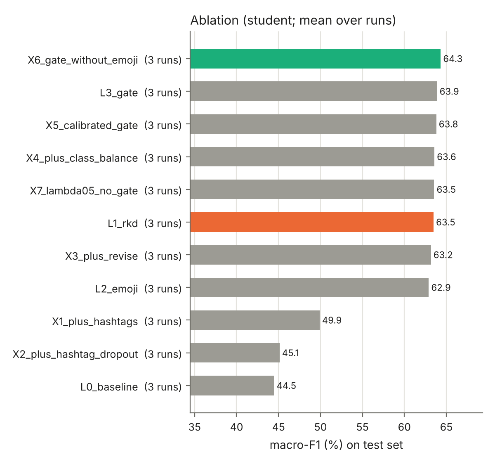
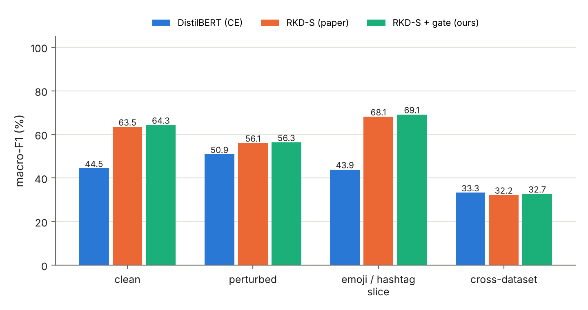

# GPU results: real BERT / DistilBERT (Kaggle, step-by-step ladder)

**Setup.** `notebooks/gpu_ladder.ipynb` on Kaggle (CUDA). Teacher: `bert-base-uncased`
(109.48 M parameters); student: `distilbert-base-uncased` (66.95 M). Both counts match the base
paper's Table III exactly. Hyper-parameters as in the paper: lr 1e-5, batch 32/64,
(ρ, π) = (0.1, 0.1), (α, γ, τ, λ) = (0.2, 2, 0.3, 0.8) for SE and (0.6, 2, 0.3, 0.8) for DV;
5 epochs, best epoch chosen by validation macro-F1. SemEval: 3 seeds (42, 1, 2). Davidson:
fold 0 of 5, 1 seed. Raw results: `docs/gpu/results/`; full tables: `docs/gpu/ladder.md`.

**Headline.** With pretrained models, the **reliability gate** is the part of our proposal that
helps: added to the paper's method (X6), it raises the student on every SemEval seed and on
Davidson, at no inference cost. The gains are small (+0.8 / +0.9 macro-F1) and significant in 2
of 4 paired tests. **Emoji → text did not help with pretrained BERT**, unlike in the CPU pilot.
Keeping hashtags is strongly harmful (−14 macro-F1), which confirms the HatEval hashtag shift.

---

## 1. SemEval-2019 (student, mean ± std over 3 seeds)

| Step | Change | Macro-F1 | Acc | Hate-F1 | ECE ↓ | Perturbed | Cross → DV |
|---|---|---|---|---|---|---|---|
| L0 | DistilBERT, raw text, CE | 44.5 ± 0.4 | 49.8 | 61.7 | 37.9 | 50.9 | 33.3 |
| **L1** | **paper's RKD (before)** | 63.5 ± 0.6 | 63.6 | 65.8 | 2.7 | 56.1 | 32.2 |
| L2 | L1 + emoji → text | 62.9 ± 0.6 | 63.1 | 65.7 | 2.3 | 54.4 | 31.3 |
| L3 | L2 + gate | 63.9 ± 1.6 | 64.1 | 66.1 | 2.8 | 54.5 | 32.0 |
| **X6** | **L1 + gate (ours, recommended)** | **64.3 ± 1.0** | **64.4** | **66.2** | 2.8 | **56.3** | 32.7 |

**Per seed, paper (L1) vs. ours (X6):**

| Seed | L1 | X6 | Δ | McNemar p | Verdict |
|---|---|---|---|---|---|
| 42 | 62.6 | 63.1 | +0.5 | 0.17 | not significant |
| 1 | 64.1 | 64.5 | +0.4 | 0.45 | not significant |
| 2 | 63.7 | 65.4 | +1.7 | < 0.0001 | X6 significantly better |

The gate improves the paper's student on all three seeds (+0.8 on average) but is significant on
only one. The emoji step on its own (L2) is slightly *worse* than L1 (−0.6; significantly worse
on 1 of 3 seeds), and L3 (emoji + gate) is below X6 (gate only).

### Extra changes (each added to L3, 3 seeds)

| Step | Change | Macro-F1 | Δ vs L3 | McNemar vs L3 |
|---|---|---|---|---|
| X1 | + hashtags kept as words | 49.9 | **−14.0** | 3/3 significantly worse |
| X2 | + hashtag dropout 0.5 | 45.1 | **−18.8** | 3/3 significantly worse |
| X3 | + revise wrong soft labels | 63.2 | −0.7 | 2/3 significantly worse |
| X4 | + class-balanced KD | 63.6 | −0.3 | 1/3 significantly worse |
| X5 | calibrated gate | 63.8 | −0.1 | 0/3 |
| X7 | λ = 0.5 instead of the gate | 63.5 | −0.4 | 1/3 significantly worse |

The teachers show the same pattern: RKD-T 66.9, emoji teacher 66.7, hashtag teachers 54.3 and 52.7.




## 2. Davidson (fold 0, 1 run)

| Step | Change | Acc | W-F1 | Macro-F1 | Hate P | Hate R | Hate-F1 | ECE ↓ |
|---|---|---|---|---|---|---|---|---|
| L0 | DistilBERT, raw text, CE | **94.5** | **94.2** | **71.8** | 53.4 | 41.3 | 46.5 | **1.1** |
| **L1** | **paper's RKD (before)** | 92.0 | 92.7 | 70.3 | 37.2 | 57.0 | 45.0 | 15.6 |
| L2 | L1 + emoji → text | 93.5 | 93.6 | 70.9 | 44.2 | 46.5 | 45.3 | 13.9 |
| L3 | L2 + gate | 92.4 | 92.9 | 70.0 | 38.1 | 52.1 | 44.0 | 17.8 |
| **X6** | **L1 + gate (ours)** | 92.6 | 93.2 | **71.2** | 40.0 | 55.2 | **46.4** | 15.5 |

* X6 vs. L1: +0.9 macro-F1, **McNemar p = 0.0007 (significant)**.
* In our reproduction, the plain DistilBERT baseline (L0) is at least as good as RKD on Davidson
  (W-F1 94.2 vs. 92.7). RKD's focal loss (α = 0.6) trades precision for recall on the hate
  class and leaves the students badly calibrated (ECE 15–18 % vs. 1.1 %).
* One fold only: run folds 1–4 before drawing firm conclusions on Davidson.

## 3. Reproduction check against the paper (Table II)

| Model | Paper | Ours (GPU) | Gap |
|---|---|---|---|
| SE BERT (M-F1) | 53.1 | 48.2 | −4.9 |
| SE DistilBERT (M-F1) | 49.1 | 44.5 | −4.6 |
| SE RKD-T (M-F1) | 71.9 | 66.9 | −5.0 |
| SE RKD-S (M-F1) | 71.5 | 63.5 | −8.0 |
| DV BERT (W-F1) | 94.7 | 94.2 | −0.5 |
| DV DistilBERT (W-F1) | 94.7 | 94.2 | −0.5 |
| DV RKD-S (W-F1) | 95.5 | 92.7 | −2.8 |

The paper's code is not public, so a gap is expected. The baselines differ by about 5 points on
SE as well, which suggests a setup difference (data version, number of epochs, model selection)
rather than an error in the RKD-specific code. Points to state in the thesis:
* We use the TweetEval release of HatEval (same split, user names anonymised); the paper may use
  the raw release.
* The paper reports neither the number of epochs nor how the checkpoint was selected; we use 5
  epochs and validation macro-F1.
* Recommended check: the best official HatEval English sub-task A system scored about 0.65
  macro-F1 (Basile et al. 2019; value from memory, **verify in the task overview**). Our 63.5–64.3
  is close to that, while the paper's 71.5 is well above it.

## 4. Efficiency (Kaggle GPU, batch size 1)

| | Parameters | Size | Latency |
|---|---|---|---|
| Teacher (BERT) | 109.48 M | 417.7 MB | 9.81 ms |
| Student (DistilBERT) | 66.95 M (−38.8 %) | 255.4 MB | 4.64 ms (−52.7 %) |

The paper reports −38.85 % parameters and −40.45 % latency. The gate changes only the training
loss, so our student has exactly this cost.

## 5. Pilot (CPU, from scratch) vs. GPU (pretrained): what changed

| Component | CPU pilot (small models trained from scratch) | GPU (pretrained BERT / DistilBERT) |
|---|---|---|
| Emoji → text | helped the teacher on 3/3 seeds | no gain (SE −0.6, DV +0.6) |
| Gate | +2.5 on top of emoji | +0.8 SE, +0.9 DV on top of RKD |
| Hashtags kept | −7 | −14 |
| Revision / class balance / calibrated gate | no gain | no gain |
| Best variant vs. RKD | +5.1 (significant 3/3) | +0.8 SE (sig. 1/3), +0.9 DV (sig.) |

Likely reasons (not tested directly): only 7 % of SE training tweets and 11.5 % of test tweets
contain an emoji, so emoji handling can move the total score only a little. A pretrained model
also starts from strong text knowledge, and a from-scratch model gains more from every extra
word. The pilot's larger gains came partly from its much noisier baseline (std 3.8 vs. 0.6).

## 6. What this means for the thesis

* **Proposed method:** RKD + reliability-gated distillation (`--method rkd_gate`; ladder step
  X6). It gives a consistent but small improvement at zero inference cost.
* **Analysis contributions:** (i) a reproduction of RKD with real models and an honest gap
  analysis; (ii) seven single-change ablations with significance tests, including emoji
  normalisation, which helps from-scratch models but not pretrained ones; (iii) quantification of
  the HatEval hashtag shortcut (−14 to −19 macro-F1 when hashtags are kept); (iv) calibration and
  cross-dataset evaluation of KD students.
* **To strengthen the gate result cheaply:** more paired runs of only L1 and X6, which share one
  teacher:
  ```bash
  STEPS="L1_rkd X6_gate_without_emoji" DATASET=se SEEDS="3 4" bash scripts/run_ladder.sh
  STEPS="L1_rkd X6_gate_without_emoji" DATASET=dv FOLDS="1 2 3 4" SEEDS="42" bash scripts/run_ladder.sh
  ```
  That gives 5 SE seeds and 5 DV folds of paired comparisons.
