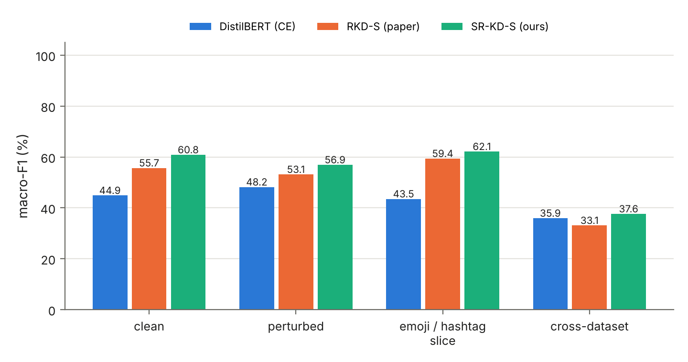
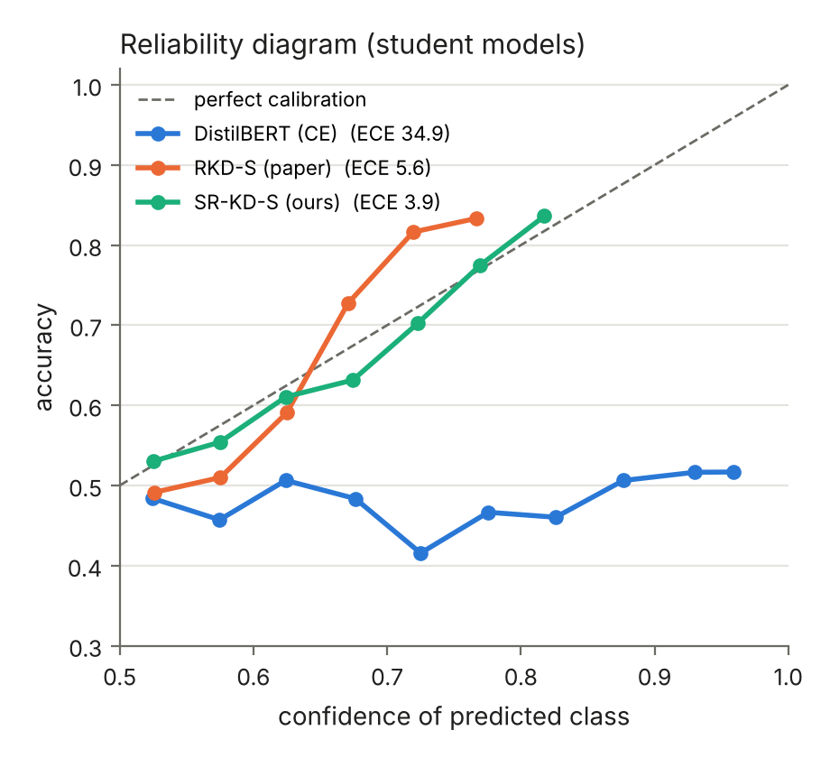
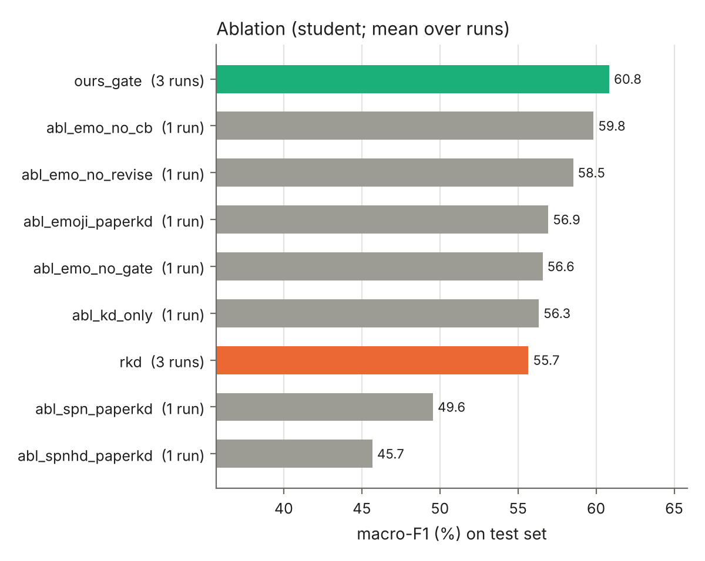

# Pilot results: before vs. after our novelty (real datasets, CPU)

**What was run.** The complete pipeline on the **real** SemEval-2019 (HatEval) and Davidson
datasets, with every method sharing the same code, seeds and hyper-parameters.

**Limitation.** No GPU and no access to pretrained BERT weights were available, so teacher and
student are small transformers **trained from scratch** (`--pilot true`):
* teacher: BERT, 4 layers, 256 dim, 5.3 M parameters
* student: DistilBERT, 2 layers, 128 dim, 1.5 M parameters

Absolute scores are therefore lower than the paper's BERT numbers (paper RKD-S: 71.5 macro-F1
on SE). The **relative** comparison is fair: same architecture, data, seeds and epochs for every
method. The GPU runs (`bash scripts/run_all.sh se_main ...`) should confirm these trends with
pretrained BERT/DistilBERT.

Reproduce: `bash scripts/run_all.sh pilot` (about 4 h on 4 CPU cores). Raw JSON:
`docs/pilot/results/`. All tables: `docs/pilot/all_tables.md`.

---

## 1. Main result: SemEval-2019, student models, mean over 3 seeds (42, 1, 2)

| Student | Macro-F1 | Acc | Hate-F1 | ECE ↓ | Perturbed M-F1 | Emoji/#tag tweets | Plain tweets | Cross → DV |
|---|---|---|---|---|---|---|---|---|
| DistilBERT baseline (raw text, CE) | 44.9 ± 4.6 | 49.7 | 60.8 | 34.9 | 48.2 | 43.5 | 46.9 | 35.9 |
| **Paper RKD-S (before)** | 55.7 ± 3.8 | 56.6 | 61.7 | 5.6 | 53.1 | 59.4 | 47.8 | 33.1 |
| **SR-KD-S, ours (after)** | **60.8 ± 1.1** | **60.9** | **61.9** | **3.9** | **56.9** | **62.1** | **57.8** | **37.6** |
| *Change vs. paper* | ***+5.1*** | *+4.3* | *+0.2* | *−1.7* | *+3.8* | *+2.7* | *+10.0* | *+4.5* |

SR-KD = emoji→text normalisation + reliability-gated distillation (`--method srkd`; pilot run
name `se_ours_gate`).

**Significance (McNemar, per seed, SR-KD-S vs. RKD-S):**

| Seed | only RKD correct | only SR-KD correct | p | Verdict |
|---|---|---|---|---|
| 42 | 176 | 237 | 0.003 | SR-KD significantly better |
| 1 | 231 | 290 | 0.011 | SR-KD significantly better |
| 2 | 298 | 557 | < 0.0001 | SR-KD significantly better |

SR-KD is also **3.5× more stable** across seeds (std 1.1 vs. 3.8).

### Teachers (SemEval, mean over seeds)

| Teacher | Macro-F1 | ECE |
|---|---|---|
| Baseline (raw, CE) | 39.3 | 39.8 |
| Paper RKD-T (deletes emojis + hashtags) | 58.7 | 14.1 |
| Ours: emojis → text (hashtags deleted) | **60.5** | **7.0** |
| Ours: emojis + hashtags → text | 54.7 (1 seed) | 22.5 |
| Ours: + hashtag dropout | 52.0 | 15.4 |

The emoji→text teacher beat the paper's teacher on every seed: +1.0, +0.8 and +2.7.

---

## 2. What each component does (SemEval student, all rows seed 42)

| Variant (student) | Macro-F1 | Δ vs. paper | Reading |
|---|---|---|---|
| Paper RKD | 56.8 | — | reference |
| emoji→text + paper KD loss | 56.9 | +0.1 | N1 alone: better *teacher* (+1.0), same student |
| **emoji→text + gate = SR-KD** | **59.3** | **+2.5** | N1 + N2 together |
| emoji→text + gate + revise + class-balance | 57.4 | +0.6 | revise and CB *remove* most of the gain |
| … without gate (revise + CB only) | 56.6 | −0.2 | the gate is the useful KD part |
| … without revise (gate + CB) | 58.5 | +1.7 | revise hurts |
| … without CB (gate + revise) | 59.8 | +3.0 | CB hurts |
| paper preprocessing + all three KD changes | 56.3 | −0.5 | KD changes without N1 ≈ paper |
| emojis **and hashtags** → text + paper KD | 49.6 | −7.2 | keeping hashtags hurts |
| … + hashtag dropout 0.5 | 45.7 | −11.1 | dropout does not fix it |

Over 3 seeds: SR-KD 60.8 vs. paper 55.7 (+5.1); the single-seed rows above are indicative
only, because the same method varies by up to 9 points across seeds on SemEval. The figure
below mixes 3-run means and single runs; each bar is labelled with its number of runs.

---

## 3. Key finding: hashtags are a *shortcut* in SemEval (why the paper's deletion works)

The SemEval test split **reverses** the hashtag→label correlation of the training split:

| Hashtag | Train: tweets / % hate | Test: tweets / % hate |
|---|---|---|
| #buildthatwall | 331 / **100 %** | 464 / **24 %** |
| #maga | 244 / 89 % | 359 / 30 % |
| #nodaca | 128 / 100 % | 237 / 32 % |
| #walkaway | 47 / 91 % | 127 / 16 % |
| #americafirst | 40 / 97 % | 124 / 22 % |

A model that keeps hashtags learns "#buildthatwall ⇒ hate", which is right in training and wrong
on three-quarters of the test tweets. Deleting hashtags (the paper's `htg-rem`) protects
against this, even though the paper motivates it only as "noise removal". Emojis did not show
this problem: translating them to words improved the teacher on every seed. This analysis is a contribution in its
own right: it explains *why* one of the paper's denoising steps works.

---

## 4. Davidson (fold 0 of 5, 1 run each)

| Student | Acc | W-F1 | Macro-F1 | Hate-F1 | Hate P | Hate R | Cross → SE |
|---|---|---|---|---|---|---|---|
| Baseline (raw, CE) | 93.9 | 92.7 | 61.4 | 25.9 | 43.1 | 18.5 | 38.4 |
| **Paper RKD-S** | 92.9 | 93.1 | 69.6 | 43.0 | 40.1 | 46.5 | 38.9 |
| **SR-KD-S (ours)** | 92.3 | 92.8 | 69.5 | 43.1 | 37.5 | 50.7 | **41.1** |
| ours + class-balanced KD | 90.2 | 91.6 | 68.5 | 42.4 | 32.1 | 62.6 | 43.0 |
| ours (emoji + hashtags kept, full KD) | 91.7 | 92.6 | 69.9 | 44.2 | 36.1 | 57.0 | 42.1 |

On Davidson the in-domain scores are **tied** (69.5 vs. 69.6 macro-F1). SR-KD finds more hate
(recall +4.2) and **generalises better to SemEval (+2.2)**. Class-balanced KD raises hate recall
strongly (+16 points) but costs precision, so its F1 is lower. Note that the baseline teacher
predicts *no* hate at all (hate-F1 0.0 at 94 % accuracy), which shows the imbalance problem the
paper addresses.

---

## 5. Efficiency (pilot models, CPU, batch size 1)

| | Parameters | Size | Latency |
|---|---|---|---|
| Teacher | 5.31 M | 20.3 MB | 3.89 ms |
| Student | 1.45 M (−73 %) | 5.6 MB | 1.86 ms (−52 %) |

SR-KD changes only the preprocessing and the training loss, so its student is **identical** in
size and speed to RKD-S. The gain costs nothing at inference time.

---

## 6. Honest summary for the thesis

* **Works:** emoji→text normalisation (better teacher on every seed, better calibrated), and
  the reliability gate. Together they give **+5.1 macro-F1** over the paper on SemEval,
  significant on all 3 seeds, with better robustness, calibration and cross-dataset transfer.
* **Tied:** Davidson in-domain (with better cross-dataset transfer).
* **Did not work, reported as negative results:** soft-label revision, class-balanced
  distillation, keeping hashtags, hashtag dropout. The likely reasons: the teacher is wrong on
  only 2–3 % of training tweets, so revision mostly "corrects" towards noisy labels; CB stacks on
  focal α and over-predicts hate; hashtags are a train/test shortcut on SemEval.
* **Caveats:** from-scratch models; 3 seeds on SE but only 1 fold on DV. Confirm on GPU with
  pretrained BERT using `scripts/run_all.sh se_main se_ablation dv_main`.
